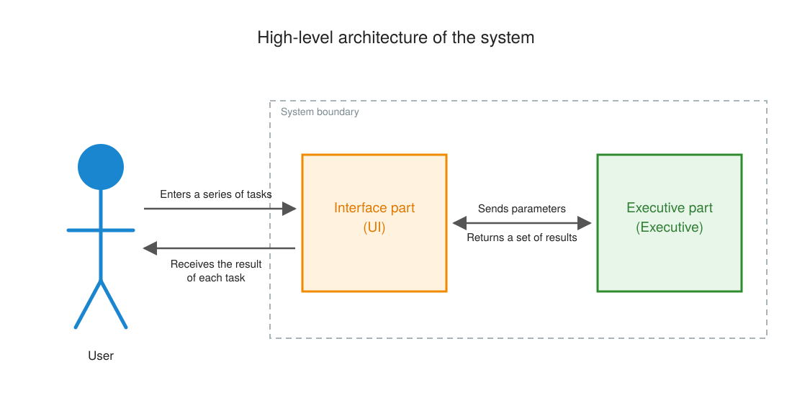

# Site Health Checker

A command-line tool that checks the health of websites: whether the domain resolves, the port is open, the server responds, and the SSL certificate is valid. The checks for one site run in parallel, and their results are combined into a single score from 0 to 100.

Built as an independent assignment for an Operating Systems course. The main point is the architecture: two processes that communicate only by passing messages through a pipe.



## Architecture

| Part | File | Responsibility |
|---|---|---|
| Interface (UI) | `healthcheck/ui.py` | accepts a series of tasks, sends parameters, consolidates results, keeps statistics |
| Executive | `healthcheck/executive.py` | separate process; runs handlers in parallel (thread pool) and returns a set of results |
| Handler registry | `healthcheck/handlers.py` | seven checks (see below); each returns a 0–100 score and a description |

**Message protocol** (`multiprocessing.Pipe`):

```
Executive → UI   {"handlers": {name: description}}        once, on start
UI → Executive   {"value": address, "handlers": [...],
                  "trace": bool}                          task parameters
Executive → UI   {"value": address, "results": [...],
                  "trace": [...] | None}                  set of results
UI → Executive   None                                     shutdown
```

### Handlers

| Handler | What it checks | Scoring |
|---|---|---|
| `dns` | the domain resolves | 100 if under 50 ms, down to 20 at 1 s |
| `tcp` | the port accepts connections | 100 if under 100 ms, down to 20 at 1.5 s |
| `http` | response status and load time | 2xx/3xx scored by speed; 4xx = 40; 5xx = 10 |
| `ssl` | certificate is valid and not expiring | >30 days = 100; 8–30 = 60; 0–7 = 20; expired or no HTTPS = 0 |
| `redirect` | plain `http://` redirects to `https://` | redirect to HTTPS or no plain HTTP at all = 100; redirect elsewhere = 40; plain HTTP error = 30; plain HTTP served = 20 |
| `headers` | security headers: HSTS, CSP, `X-Content-Type-Options`, `X-Frame-Options`, `Referrer-Policy` | 20 points per header found |
| `ipv6` | the domain has an IPv6 (AAAA) address | IPv6 = 100; IPv4 only = 50 |

A check that cannot be completed (timeout, refused connection, invalid certificate) scores 0.

**A task** is a value (a site address) plus a list of handlers. If no handlers are given, all of them run.
**Consolidation**: average by default (`avg`), `min` to score a site by its weakest check, or `median` so that a single bad check does not dominate.
**Verdict**: ≥80 is `OK`, 50–79 is `WARN`, <50 is `FAIL`.

## Usage

Requires Python 3.9+ and nothing else: only the standard library is used.

```bash
# tasks from arguments
python -m healthcheck "github.com" "wikipedia.org dns http" "http://localhost:8000"

# interactive: the system prompts for tasks, an empty line quits
python -m healthcheck

# consolidate by minimum / run handlers sequentially to compare timing
python -m healthcheck -c min "github.com"
python -m healthcheck -s "github.com" "wikipedia.org"

# show a timeline of which process/thread did what
python -m healthcheck -t "github.com"
```

### Options

```
usage: python -m healthcheck [-h] [-c FUNC] [-s] [-t] [TASK ...]

positional arguments:
  TASK                  a task in quotes, e.g. "github.com dns http"; if none
                        are given, the system prompts for them

options:
  -h, --help            show this help message and exit
  -c, --consolidate FUNC
                        how to combine handler scores: avg, min, median
                        (default: avg)
  -s, --sequential      run handlers one by one instead of in parallel
  -t, --trace           show a timeline of which process/thread did what for
                        each task
```

`python -m healthcheck -h` also lists the task format, the handlers, and examples.

Example output:

```
[1] http://localhost:8765
    dns   100  1 address(es), e.g. 127.0.0.1
    tcp   100  port 8765 open, 2 ms
    http  100  HTTP 200, 8 ms
    ssl     0  site does not use HTTPS
    => health: 75/100 (WARN), 10 ms

=== Summary ===
Sites checked:   2
Invalid inputs:  1
Verdicts:        OK: 1, WARN: 1
Average health:  88/100
handler     calls  failed   avg time
dns             2       0       1 ms
http            2       0       4 ms
...
```

## Tracing (`-t`)

The trace shows events from both processes on one timeline, one column per process or thread, in the spirit of OSTEP's `x86.py -c`:

```
      ms  ui                executive         worker_0          worker_1          worker_2
    ----------------------------------------------------------------------------------------
     0.0  send task
     0.4                    recv task
     0.6                                      dns start
     1.0                                                        tcp start
     1.2                                                                          http start
     4.1                                      dns done (100)
     4.1                                      ssl start
     4.1                                      ssl done (0)
     4.4                                                        tcp done (100)
    19.4                                                                          http done (100)
    19.5                    send results
    19.6  recv results
```

Things to notice:
- the UI blocks between `send task` and `recv results`, while the executive works;
- in parallel mode the checks overlap in time, and `worker_0` picks up `ssl` as soon as it finishes `dns`: the thread pool reuses threads;
- with `-s` all checks run one after another in the `executive` column.

Context switches and interrupts themselves are handled by the OS and are not visible from Python; the trace shows their effect, the interleaving of work between threads. Timestamps come from `time.monotonic()`, which is system-wide, so events from both processes share one clock.

## Tests

The tests need no internet connection: they start a local HTTP server.

```bash
python -m unittest -v
```

## Adding a handler

Write a function in `handlers.py` that takes an address and returns `(score, detail)`, then add it to the `HANDLERS` dict. The first line of its docstring becomes its description in the menu.
